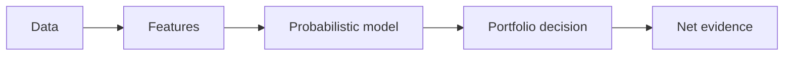

<div align="center">

# moe-factor-timing v2

**A reproducible benchmark for probabilistic regime-aware factor allocation.**

[](https://www.python.org/)
[](https://github.com/kira-ml/moe-factor-timing-v2/actions/workflows/ci.yml)
[](LICENSE)
[](#what-this-is)
[](#key-result)
[](docs/12_legal_ethical_security_review.md)

`1963–2026` · `6 US equity factors` · `627 out-of-sample decisions` · `248-month holdout` · `1/N benchmark`

</div>

| Start here | Evidence | Reproduce |
|:---|:---|:---|
| [Research question](#research-question)<br>[What this is](#what-this-is) | [Key result](#key-result)<br>[Evidence design](#evidence-design)<br>[Why this matters](#why-this-matters) | [Quick start](#quick-start)<br>[Repository map](#repository-map)<br>[Documentation](#documentation) |

---

## Research question

> **Can a probabilistic mixture-of-experts model allocate across equity factor portfolios better than naive equal weight, after realistic costs, out of sample?**

This is a **research benchmark**, not a trading strategy. The question is deliberately narrow: six US equity factors, monthly long-only allocation, a 1/N benchmark, a pre-committed holdout, and net-of-cost evaluation. The point is not to find a model that looks good in-sample; it is to test whether a small conditional signal survives the full chain from forecast to portfolio to net return.

---

## Key result

The MoE finds a small full-sample signal. It does **not** beat 1/N at the pre-committed 10 bps cost, and the confirmatory holdout is **inconclusive**, not equivalent.

<!-- RESULT_START -->

| | 1/N | MoE |
|---|---:|---:|
| **Full OOS net Sharpe** (1974–2026) | **1.059** | **0.790** |
| **Holdout net Sharpe** (2006–2026) | **0.505** | **0.479** |
| **Holdout gross Sharpe** | 0.511 | 0.622 |
| **Full OOS IC** (627 months) | — | 0.057 (HAC t = 2.97) |
| **Holdout IC** (248 months) | — | 0.040 (t = 1.35) |

**Holdout net difference:** `−0.026` · 95% CI `[−0.470, 0.389]` · `p = 0.862`

**MoE holdout net Sharpe by cost:** `0.551 → 0.479 → 0.336` at `5 → 10 → 20 bps`. The sign flips between 5 and 10 bps; the underlying gross difference is within noise.

> **The one-sentence lesson:** predictive signal, gross Sharpe, and net decision value are three different objects.

<details>
<summary><strong>Full result, uncertainty, and calibration</strong></summary>

The mixture-of-experts model **does not beat 1/N at the pre-committed 10 bps cost**.

In the pre-committed 2006–2026 holdout, the MoE has a net Sharpe of **0.479** versus **0.505** for 1/N. The difference is **−0.026** with a block-bootstrap 95% confidence interval **`[−0.470, 0.389]`** (p = 0.862). The data cannot distinguish the two at the pre-committed confidence level; this is an **inconclusive** result, not evidence of equivalence.

Over the full 1974–2026 out-of-sample window, 1/N is ahead: **1.059** versus **0.790** for the MoE (difference −0.269; 95% CI `[−0.518, 0.006]`). 1/N also wins all three subperiods.

The gross/net decomposition is informative but is **not** a positive-alpha claim. The MoE's full-sample cross-sectional information coefficient is **0.057** (HAC t = 2.97), but the 2006–2026 holdout IC is **0.040** (t = 1.35), and the holdout gross Sharpe difference (0.622 vs 0.511) has a 95% CI **`[−0.324, 0.514]`**. The holdout gross edge is not statistically confirmed.

The cost sensitivity is the most important caveat. In the holdout, the MoE's net Sharpe is **0.551 at 5 bps**, **0.479 at 10 bps**, and **0.336 at 20 bps**, versus 1/N at 0.508, 0.505, and 0.498. The sign flips between 5 and 10 bps, but the underlying gross difference is within noise. The 5 bps result must not be presented as an edge. Over the full sample, even the gross Sharpe is below 1/N (0.934 vs 1.066).

The model is also miscalibrated in the tails: **10.9%** of PIT values fall in each 5% tail, and **0/6** assets pass the 5% KS threshold. Restart and decision-rule sensitivities do not change the ranking.

**Bottom line:** the MoE produced a small full-sample signal, but it did not survive the holdout or the pre-committed cost. 1/N remains hard to beat; the confirmatory holdout is inconclusive, not a win for either model.

</details>

<!-- RESULT_END -->

The full report, including confidence intervals, calibration, turnover, power, and limitations, is in [`reports/v2_report.md`](reports/v2_report.md).

---

## What this is

| **This is** | **This is not** |
|:---|:---|
| A **long-sample test**: 759 monthly observations from 1963-07 to 2026-09. | A trading strategy, a fund, or investment advice. |
| A **pre-committed protocol**: fixed hyperparameters, a 2006+ holdout, and no selection on the evaluation window. | A claim that regimes exist or that the latent components are economically identified. |
| A **proper probabilistic MoE**: a mixture of linear Gaussian experts trained by EM, with a predictive mean and covariance. | A claim that the Ken French research panel is a literal point-in-time trading record. |
| A **decision-focused evaluation**: net Sharpe, mean-variance utility, drawdown, turnover, cost drag, PIT calibration, block-bootstrap uncertainty, power, and a deflated Sharpe ratio. | A live-performance claim. Backtest results do not imply live results. |
| A **reproducible pipeline**: typed configs, contract tests, a deterministic solver, and a manifest with SHA-256 hashes. | A deep-learning benchmark. A neural MoE is a different hypothesis. |

See [`docs/01_problem_framing.md`](docs/01_problem_framing.md) for the full scope and non-goals.

---

## Evidence design

| Design choice | Why it is there |
|:---|:---|
| 759 monthly observations, 1963-07 to 2026-09 | Long sample for statistical power |
| 627 out-of-sample monthly decisions | Chronological walk-forward, one decision per month |
| 248-month holdout, 2006-01 to 2026-08 | Confirmation separate from selection |
| 1/N equal-weight benchmark | Strong, low-turnover outside option |
| 10 bps one-way cost | Pre-committed implementation burden |
| 3-expert linear-Gaussian MoE | Small, tractable probabilistic model |
| Block bootstrap, HAC IC, PIT/KS, MDE, DSR | Dependence, calibration, power, and selection diagnostics |

**Validation:** 242/242 independent checks passed, and 41/41 compared artifacts reproduced identically in a fresh run. See [`docs/13_validation_report.md`](docs/13_validation_report.md).

---

## Why this matters

A model can rank factors correctly and still be a worse portfolio. The chain is:

```text
signal → forecast → weights → gross return → net return → evidence
```

Each arrow can destroy value: a weak signal, an overconfident covariance, an optimizer that amplifies noise, turnover that consumes the gross return, or a holdout too short to distinguish a small effect. Version 2 reports all six links, not just the first one.

---

## Pipeline



The full pipeline is `ingest → validate → features → split → models → decision → backtest → evaluate → report → manifest`.

Every boundary has a typed contract. The engine fails loudly on a model error, counts solver fallbacks, and refuses to publish a result if the fallback rate exceeds 5%. The manifest binds the result to its config, data snapshot, code commit, package versions, and artifact hashes.

---

## Quick start

**Requirements:** Python 3.10+ and a working `pip`.

### 1. Clone and install

```bash
git clone https://github.com/kira-ml/moe-factor-timing-v2.git
cd moe-factor-timing-v2
python -m venv venv

# Windows
venv\Scripts\activate
# macOS / Linux
# source venv/bin/activate

python -m pip install -e ".[dev]" -c constraints.txt
```

### 2. Fetch the reference panel

```bash
python scripts/fetch_reference_data.py
```

The Ken French factor panel is downloaded from the source and is **not redistributed** with the public repository. The repository ships a downloader, provenance metadata, and SHA-256 checksums. See [`data/README.md`](data/README.md) and [`docs/12_legal_ethical_security_review.md`](docs/12_legal_ethical_security_review.md).

### 3. Validate and run

```bash
# Validate the data contract
python -m moe_factor_timing validate --config configs/default.yaml

# Run the reference pipeline
python -m moe_factor_timing run --config configs/default.yaml --run-id reference --publish

# Fast implementation smoke test (not a research result)
python -m moe_factor_timing run --config configs/smoke.yaml --run-id smoke

# Tests and lint
python -m pytest tests/ -q
python -m ruff check .
```

For a guided first run, open [`notebooks/quickstart.ipynb`](notebooks/quickstart.ipynb). It validates the data, runs the smoke configuration, and displays the metrics table. The smoke run is an implementation check, not the research result.

---

## Repository map

| Path | Contents |
|:---|:---|
| `.github/workflows/` | CI: lint, tests, and the public-tree guard |
| `configs/` | Reference and smoke configurations |
| `constraints.txt` | Pinned reference environment |
| `data/reference/` | Provenance metadata and downloader; raw CSV is local-only |
| `docs/` | Problem framing, data contract, methodology, protocol, architecture, lessons, validation, extension guide |
| `notebooks/` | Quickstart notebook for the smoke configuration |
| `paper/` | Research paper PDF and citation record |
| `reports/` | Curated reference report and figures |
| `runs/` | Immutable run artifacts (git-ignored) |
| `scripts/` | Data refresh, analysis, and public-tree guard |
| `src/moe_factor_timing/` | Installable package |
| `tests/` | Contract, leakage, accounting, evaluation, and end-to-end tests |
| `publication/` | One-page research note (PDF/PNG) and build source |
| `archive/v1/` | Version 1 reference (local-only, read-only, fingerprinted) |
| `CONTRIBUTING.md` | Development checks and contribution rules |
| `DECISIONS.md` | Material decisions and review dates |

---

## Documentation

| Document | What it answers |
|:---|:---|
| [`paper/moe_factor_timing_benchmark.pdf`](paper/moe_factor_timing_benchmark.pdf) | Research paper: methodology, results, discussion, and limitations |
| [`notebooks/quickstart.ipynb`](notebooks/quickstart.ipynb) | Guided smoke run and metrics table |
| [`reports/v2_report.md`](reports/v2_report.md) | Full report: intervals, calibration, turnover, power, and limitations |
| [`publication/one_pager.pdf`](publication/one_pager.pdf) | One-page research summary |
| [`docs/01_problem_framing.md`](docs/01_problem_framing.md) | Research question, hypotheses, scope, falsification |
| [`docs/02_data_contract.md`](docs/02_data_contract.md) | Data source, schema, point-in-time contract, caveats |
| [`docs/03_methodology.md`](docs/03_methodology.md) | Features, models, decision rule, costs, walk-forward |
| [`docs/04_evaluation_protocol.md`](docs/04_evaluation_protocol.md) | Endpoints, uncertainty, power, multiple testing, kill criteria |
| [`docs/05_architecture.md`](docs/05_architecture.md) | Module map, interfaces, invariants, extension points |
| [`docs/06_lessons_from_v1.md`](docs/06_lessons_from_v1.md) | Diagnosis of Version 1 and what V2 changes |
| [`docs/07_reproducibility.md`](docs/07_reproducibility.md) | Reproduce, verify, and audit a run |
| [`docs/08_risk_register.md`](docs/08_risk_register.md) | Pre-mortem, risks, counter-metrics, rollback |
| [`docs/09_sensitivity.md`](docs/09_sensitivity.md) | Restart audit and decision-rule sensitivity |
| [`docs/10_reference_run.md`](docs/10_reference_run.md) | Reference run manifest and verification record |
| [`docs/11_red_team_validation.md`](docs/11_red_team_validation.md) | Publication gate and red-team findings |
| [`docs/12_legal_ethical_security_review.md`](docs/12_legal_ethical_security_review.md) | Data, licensing, font, secrets, and publication-safety review |
| [`docs/13_validation_report.md`](docs/13_validation_report.md) | Independent reproducibility audit, 242 checks, public-release verification |
| [`docs/14_extension_guide.md`](docs/14_extension_guide.md) | How to add a model to the registry and evaluate it |

---

## Limitations

| Limitation | Consequence |
|:---|:---|
| The Ken French panel is reconstructed from the current CRSP database. | It is not a literal vintage or a live trading record. |
| The allocation is a fund-of-factor-strategies interpretation. | Internal turnover inside each long-short factor portfolio is not modelled. |
| Long-only, fully invested, monthly frequency, US equity factors only. | The scope is explicit; it is not a general asset-allocation model. |
| The holdout is 20 years. | The study is underpowered for small Sharpe improvements; the report states the minimum detectable effect. |
| No live trading, execution, market impact, or capacity estimate. | Backtest results do not imply live performance. |
| The raw Ken French panel and the V1 archive are not redistributed. | They remain local-only reference material. |

The full list is in the report and [`docs/08_risk_register.md`](docs/08_risk_register.md).

---

## Contributing

Contributions are welcome when they preserve the evidence contract and the public-tree rules. Read [`CONTRIBUTING.md`](CONTRIBUTING.md) for the development setup, checks, and pull-request expectations. To add a model, follow [`docs/14_extension_guide.md`](docs/14_extension_guide.md).

The public-tree guard runs in CI and fails if `archive/`, `runs/`, `data/reference/factors.csv`, `.env`, or a local virtual environment is tracked by git.

---

## Version 1 archive and data notice

`archive/v1/` contains the complete Version 1 implementation and outputs. It is **read-only reference material** and is never modified. It is **kept local-only and excluded from the public git tree** because it contains third-party data with unresolved redistribution terms. Its local fingerprint is checked by `tests/test_manifest.py` (the test skips on a public clone without the archive) and recorded in every local run manifest.

The prior V2 attempt is preserved in the private development repository and is **not part of this public release**.

> **History note.** This public release uses a clean history. The raw Ken French panel and the V1 archive are not part of the public tree. See [`docs/12_legal_ethical_security_review.md`](docs/12_legal_ethical_security_review.md).

---

## Citation

If you use this benchmark, please cite the Fama-French data source and this repository:

```bibtex
@misc{talingting2026moefactor,
  author       = {Talingting, Ken Ira Lacson},
  title        = {moe-factor-timing v2: A reproducible benchmark for probabilistic regime-aware factor allocation},
  year         = {2026},
  version      = {2.0.0},
  howpublished = {GitHub},
  url          = {https://github.com/kira-ml/moe-factor-timing-v2},
  note         = {Research benchmark; not investment advice}
}
```

Factor data: Fama, E. F., & French, K. R. (1993). Common risk factors in the returns on stocks and bonds. *Journal of Financial Economics, 33*(1), 3–56.

The repository also includes [`CITATION.cff`](CITATION.cff) for citation tooling.

---

## Legal and data notice

The original code and documentation are MIT-licensed. The raw Ken French panel and the V1 archive are **not redistributed** in the public tree because their source terms do not explicitly grant redistribution. The archive remains local-only and byte-identical. See [`NOTICE`](NOTICE), [`THIRD_PARTY_NOTICES.md`](THIRD_PARTY_NOTICES.md), and [`docs/12_legal_ethical_security_review.md`](docs/12_legal_ethical_security_review.md). This is not legal advice.

---

## License

MIT. See [`LICENSE`](LICENSE).

---

<div align="center">
<sub>Research benchmark · not investment advice · backtests do not imply live performance</sub>
</div>
